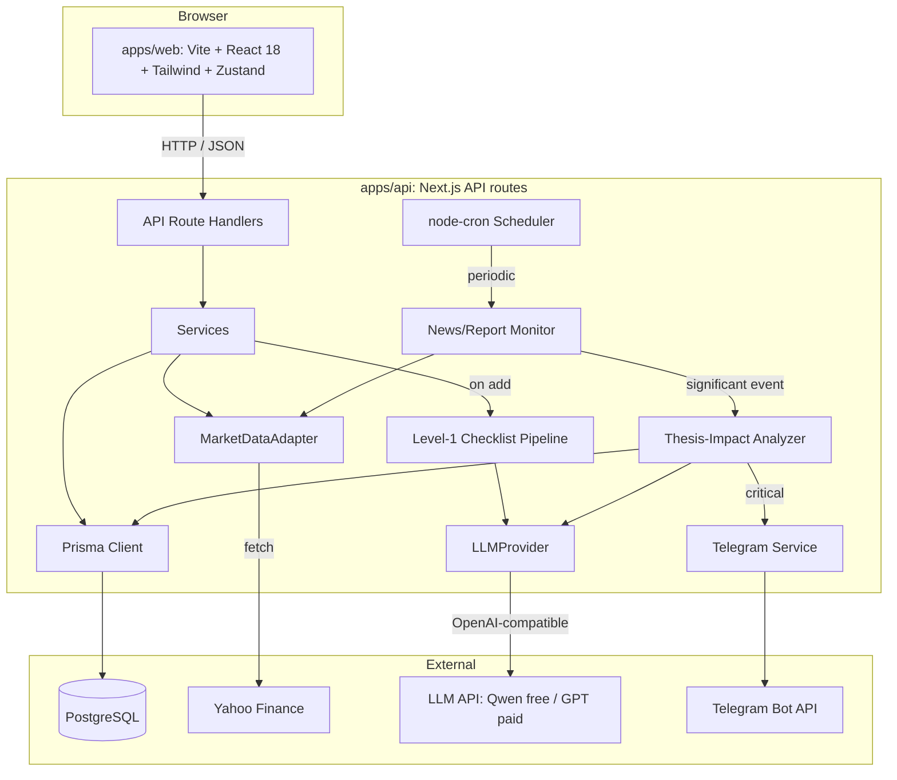

# Архитектурный план: Stock Level-1 Tracker

Сайт-трекер американских акций с двумя листами (watchlist / purchased) и аналитическим
агентом. Логика работы:

1. **При добавлении тикера** агент ОДИН раз проводит **проверку по чек-листу «Уровень 1»**
   (8 критериев), выдаёт вердикт (**PASS / PASS_WITH_WARNINGS / FAIL**), ключевые цифры
   и краткие тезисы, почему ожидается рост. Результат фиксируется в карточке тикера.
2. **Тезис** (почему ожидается рост) — редактируемое поле карточки: может быть
   сгенерирован при проверке уровня 1 **или записан пользователем вручную**.
3. **Далее агент непрерывно контролирует** новости и отчёты по компании. В карточке
   показывается дата следующего отчёта (earnings).
4. **После выхода отчёта или важной новости** (покупка бизнеса, суд и т.п.) LLM анализирует
   влияние на **текущий тезис**: **подтверждает / ломает / глобально не влияет**.
   В карточке появляется датированная пометка (note).
5. **Очень важное изменение** (критичность = высокая) → **уведомление в Telegram**.

> Каноническая версия документа. Ранее был `plans/architecture.md` (вне папки проекта) —
> он устарел, используйте этот файл.

## 1. Цель и ключевые требования

- Ввод тикеров американских акций (NYSE/NASDAQ).
- Два листа: **Watchlist** и **Purchased**.
- Добавление / удаление / перенос тикеров между листами.
- **Одноразовая** проверка по чек-листу «Уровень 1» при добавлении тикера.
- **Редактируемый тезис** (авто из чек-листа или ручной).
- **Непрерывный мониторинг** новостей и отчётов; дата следующего отчёта в карточке.
- **Анализ влияния события на тезис** (подтверждает / ломает / не влияет) → датированная пометка.
- **Telegram-уведомление** при очень важном изменении.
- Жёсткие требования: **бесплатно**, **без излишней сложности**.
- LLM — гибкая абстракция: старт на бесплатной Qwen, позже платная (GPT и т.п.) через API.

## 2. Анализ похожих готовых решений

| Решение | Что берём |
|---|---|
| **OpenBB** (open-source) | Паттерн адаптеров данных + абстракция LLM-провайдера |
| **yfinance / yahoo-finance2** экосистема | Бесплатный источник цен/новостей/фундаментала без ключа |
| **Finviz / TradingView** (UX) | Паттерн watchlist + screener, карточки тикеров, бейджи |
| **AI stock pickers** (StockGPT и др. на GitHub) | Промпт «данные → вердикт», структура ответа LLM |
| **LangChain / LlamaIndex** фин. примеры | Оркестрация конвейера: данные → промпт → LLM → парсинг |

Ключевые заимствованные паттерны: CRUD watchlist, адаптер данных, абстракция LLM,
промпт «чек-лист → вердикт», мониторинг событий, уведомления.

## 3. Стек технологий (бесплатно, просто)

| Слой | Технология | Обоснование |
|---|---|---|
| Фронтенд | **React 18 + Vite + TypeScript** | Быстрый dev, простой SPA, типобезопасность |
| Стили | **Tailwind CSS** | Быстрая вёрстка, без отдельных CSS-файлов |
| Состояние | **Zustand** | Лёгкий стейт-менеджер, минимум бойлерплейта |
| Бэкенд | **Next.js (App Router, API route handlers)** | REST API на TypeScript, server-side код |
| ORM | **Prisma** | Типобезопасный доступ к БД, миграции |
| БД | **PostgreSQL** | Бесплатная, надёжная, локально через Docker |
| Данные акций | **yahoo-finance2** (Node) | Бесплатно, без API-ключа: цены, новости, фундаментал, earnings-календарь |
| LLM | **openai SDK (OpenAI-совместимый)** | Один SDK для OpenRouter (бесплатный Qwen) / Ollama / OpenAI (платный GPT) |
| Индикаторы | **technicalindicators** (Node) | SMA/RSI/MACD и др. (доп. контекст к чек-листу) |
| Планировщик | **node-cron** + `instrumentation.ts` | Периодический мониторинг новостей/отчётов в self-hosted Next.js |
| Уведомления | **Telegram Bot API** (fetch) | Бесплатно, без SDK: `sendMessage` по токену бота |
| Тесты | **Vitest** + **React Testing Library** + **Playwright** (E2E) | Быстрые unit/integration + E2E |
| Монорепо | **npm workspaces** | Два приложения + shared-пакет в одном репо |

> Адаптер данных и LLM-провайдер сделаны интерфейсами, чтобы позже подключить
> Finnhub / Alpha Vantage (бесплатные ключи) и платные LLM без переписывания кода.

## 4. Системная архитектура



### Взаимодействие частей
- **Фронтенд ↔ Бэкенд:** REST over HTTP, JSON. CORS включён.
- **Бэкенд ↔ БД:** Prisma → PostgreSQL.
- **Бэкенд ↔ Данные:** `yahoo-finance2` (внутренний вызов, не JSON).
- **Бэкенд ↔ LLM:** OpenAI-совместимый HTTP API (JSON), конфигурируемый `baseURL`/`model`.
- **Бэкенд ↔ Telegram:** Bot API `sendMessage` (HTTP, JSON) при критичном событии.
- **Планировщик:** `node-cron` внутри Next.js (self-hosted, node runtime) периодически
  запускает мониторинг новостей/отчётов (НЕ чек-лист — он одноразовый).

## 5. Структура папок и файлов

Корень проекта: `Invest_site/`.

```
Invest_site/
├── package.json                  # npm workspaces (корень)
├── .gitignore
├── README.md
├── prompts/
│   ├── level1-checklist.md       # промпт чек-листа «Уровень 1» (из .docx)
│   └── thesis-impact.md          # промпт анализа влияния события на тезис
├── apps/
│   ├── web/                      # ФРОНТЕНД: Vite + React 18 + TS + Tailwind + Zustand
│   │   ├── index.html
│   │   ├── package.json
│   │   ├── vite.config.ts
│   │   ├── tailwind.config.js
│   │   ├── tsconfig.json
│   │   ├── .env.example          # VITE_API_URL
│   │   └── src/
│   │       ├── main.tsx
│   │       ├── App.tsx
│   │       ├── api/client.ts     # fetch-обёртка над API бэкенда
│   │       ├── store/useTickerStore.ts   # Zustand
│   │       ├── types/index.ts    # локальные типы (или из @shared)
│   │       ├── styles/index.css
│   │       ├── components/
│   │       │   ├── Layout.tsx
│   │       │   ├── TickerTable.tsx
│   │       │   ├── TickerForm.tsx
│   │       │   ├── TickerCard.tsx        # карточка: вердикт, цифры, тезис, следующий отчёт
│   │       │   ├── PriceChart.tsx
│   │       │   ├── NewsList.tsx
│   │       │   ├── AnalysisPanel.tsx     # рендер markdown-отчёта уровня 1
│   │       │   ├── CriteriaTable.tsx     # таблица 8 критериев с цветами
│   │       │   ├── VerdictBadge.tsx      # бейдж вердикта уровня 1
│   │       │   ├── ThesisEditor.tsx      # редактирование тезиса (авто/ручной)
│   │       │   └── NotesTimeline.tsx     # датированные пометки влияния на тезис
│   │       └── pages/
│   │           ├── Dashboard.tsx     # два листа: watchlist + purchased
│   │           └── TickerDetail.tsx  # карточка: график, новости, отчёт, пометки
│   └── api/                      # БЭКЕНД: Next.js API routes + Prisma + PostgreSQL
│       ├── package.json
│       ├── next.config.js
│       ├── tsconfig.json
│       ├── .env.example          # DATABASE_URL, LLM_*, TELEGRAM_BOT_TOKEN, TELEGRAM_CHAT_ID
│       ├── instrumentation.ts    # запуск node-cron при старте сервера
│       ├── jobs/scheduler.ts     # cron: периодический мониторинг новостей/отчётов
│       ├── prisma/
│       │   ├── schema.prisma
│       │   └── migrations/
│       ├── app/
│       │   ├── layout.tsx        # минимальный (API-only)
│       │   └── api/
│       │       ├── tickers/
│       │       │   ├── route.ts              # GET список, POST создать (+ запуск чек-листа)
│       │       │   └── [symbol]/
│       │       │       ├── route.ts          # GET, PATCH (тезис/лист), DELETE
│       │       │       ├── prices/route.ts
│       │       │       ├── prices/refresh/route.ts
│       │       │       ├── news/route.ts
│       │       │       ├── news/refresh/route.ts
│       │       │       ├── reports/route.ts
│       │       │       ├── notes/route.ts    # GET пометки влияния на тезис
│       │       │       └── analysis/
│       │       │           ├── route.ts      # GET результат чек-листа
│       │       │           └── run/route.ts  # POST (пере)запустить чек-лист
│       │       ├── analyze/all/route.ts
│       │       ├── health/route.ts
│       │       └── config/llm/route.ts
│       └── lib/
│           ├── prisma.ts         # singleton PrismaClient
│           ├── config.ts         # env-конфиг
│           ├── data/
│           │   ├── base.ts       # интерфейс MarketDataAdapter
│           │   ├── yahoo.ts      # yahoo-finance2 (цены, новости, фундаментал, earnings)
│           │   └── factory.ts
│           ├── llm/
│           │   ├── base.ts       # интерфейс LLMProvider
│           │   ├── openai-compat.ts
│           │   ├── prompts.ts    # загрузка промптов + парсеры (вердикт, влияние)
│           │   └── factory.ts
│           ├── analysis/
│           │   ├── data-collector.ts   # сбор данных для 8 критериев
│           │   ├── indicators.ts       # доп. тех. индикаторы
│           │   ├── checklist-pipeline.ts  # одноразовый чек-лист уровня 1
│           │   └── thesis-impact.ts    # анализ влияния события на тезис
│           └── services/
│               ├── ticker.service.ts
│               ├── price.service.ts
│               ├── news.service.ts
│               ├── report.service.ts
│               ├── analysis.service.ts
│               ├── monitor.service.ts    # мониторинг новостей/отчётов → события
│               └── telegram.service.ts   # отправка уведомлений в Telegram
├── packages/
│   └── shared/                   # общие TS-типы (Ticker, Analysis, ThesisNote, ...)
│       ├── package.json
│       └── src/types.ts
├── docs/
│   ├── architecture.md           # этот файл
│   ├── api.md
│   └── data-model.md
└── docker/
    └── docker-compose.yml        # PostgreSQL (+ опц. api, web)
```

## 6. Модель данных (Prisma)

```prisma
enum ListType { WATCHLIST  PURCHASED }
enum Level1Verdict { PASS  PASS_WITH_WARNINGS  FAIL }
enum ThesisImpact { CONFIRMS  BREAKS  NO_GLOBAL_IMPACT }
enum EventSource { REPORT  NEWS }

model Ticker {
  id             String     @id @default(cuid())
  symbol         String     @unique
  name           String?
  listType       ListType   @default(WATCHLIST)
  thesis         String?    // текущий тезис (авто из чек-листа или ручной)
  notes          String?
  nextReportDate DateTime?  // дата следующего отчёта (earnings)
  createdAt      DateTime   @default(now())
  updatedAt      DateTime   @updatedAt
  prices         PricePoint[]
  news           NewsItem[]
  reports        Report[]
  analysis       Analysis?      // результат чек-листа уровня 1 (одноразовый)
  thesisNotes    ThesisNote[]
}

model PricePoint {
  id       String   @id @default(cuid())
  tickerId String
  ticker   Ticker   @relation(fields: [tickerId], references: [id], onDelete: Cascade)
  date     DateTime
  open     Float
  high     Float
  low      Float
  close    Float
  volume   Int?
  @@unique([tickerId, date])
}

model NewsItem {
  id          String   @id @default(cuid())
  tickerId    String
  ticker      Ticker   @relation(fields: [tickerId], references: [id], onDelete: Cascade)
  title       String
  source      String?
  url         String?
  publishedAt DateTime?
  summary     String?
  processed   Boolean  @default(false)  // учтено ли в мониторинге
  @@unique([tickerId, url])
}

model Report {
  id        String   @id @default(cuid())
  tickerId  String
  ticker    Ticker   @relation(fields: [tickerId], references: [id], onDelete: Cascade)
  period    String
  revenue   Float?
  netIncome Float?
  eps       Float?
  guidance  String?
  publishedAt DateTime?
  fetchedAt DateTime @default(now())
  @@unique([tickerId, period])
}

model Analysis {
  id                 String        @id @default(cuid())
  tickerId           String
  ticker             Ticker        @relation(fields: [tickerId], references: [id], onDelete: Cascade)
  createdAt          DateTime      @default(now())
  verdict            Level1Verdict?
  verdictExplanation String?
  criteria           Json?        // [{name, actual, benchmark, rating, confidence, conclusion}]
  growthTheses       String?      // краткие тезисы, почему ожидается рост
  report             String?      // полный markdown-отчёт уровня 1
  llmModel           String?
}

model ThesisNote {
  id           String       @id @default(cuid())
  tickerId     String
  ticker       Ticker       @relation(fields: [tickerId], references: [id], onDelete: Cascade)
  date         DateTime     @default(now())
  source       EventSource
  eventTitle   String?
  impact       ThesisImpact?
  explanation  String?
  criticality  String?      // HIGH / MEDIUM / LOW
  summary      String?      // одна строка для карточки
  isCritical   Boolean      @default(false)
  telegramSent Boolean      @default(false)
  llmModel     String?
}
```

> `rating` в `criteria` хранит одну из строк: `ОЧЕНЬ ХОРОШО / ХОРОШО / НОРМАЛЬНО / ПЛОХО / Н/Д`.
> Цвета для UI заданы в [`prompts/level1-checklist.md`](../prompts/level1-checklist.md) (раздел «Цветовая шкала»).

## 7. API (REST, JSON)

**Тикеры**
- `GET /api/tickers?list=WATCHLIST|PURCHASED` → `Ticker[]`
- `POST /api/tickers` `{symbol, listType, thesis?, notes?}` → `Ticker`
  (создаёт тикер и **запускает чек-лист уровня 1**; результат в `analysis`)
- `GET /api/tickers/[symbol]` → `Ticker` (+ `analysis`, `nextReportDate`, последние `thesisNotes`)
- `PATCH /api/tickers/[symbol]` `{listType?, thesis?, notes?}` → `Ticker`
  (редактирование тезиса — ручной или авто)
- `DELETE /api/tickers/[symbol]` → `204`

**Цены**
- `GET /api/tickers/[symbol]/prices?period=1mo&interval=1d` → `PricePoint[]`
- `POST /api/tickers/[symbol]/prices/refresh` → `{fetched: n}`

**Новости**
- `GET /api/tickers/[symbol]/news` → `NewsItem[]`
- `POST /api/tickers/[symbol]/news/refresh` → `{fetched: n}`

**Отчёты**
- `GET /api/tickers/[symbol]/reports` → `Report[]`

**Пометки (влияние на тезис)**
- `GET /api/tickers/[symbol]/notes` → `ThesisNote[]`

**Анализ (уровень 1)**
- `GET /api/tickers/[symbol]/analysis` → `Analysis`
- `POST /api/tickers/[symbol]/analysis/run` → `Analysis` (пере)запустить чек-лист

**Система**
- `GET /api/health` → `{status, llmProvider}`
- `GET /api/config/llm` → текущий конфиг LLM

> Мониторинг новостей/отчётов и Telegram-уведомления запускаются планировщиком
> (внутренне), а не прямым API. При необходимости можно добавить
> `POST /api/tickers/[symbol]/monitor/run` для ручной проверки.

## 8. Конвейеры анализа

### 8.1 Одноразовый чек-лист «Уровень 1» (при добавлении тикера)

1. **Собрать данные** через `yahoo-finance2` (`analysis/data-collector.ts`):
   - текущая цена, 52-недельный и исторический максимум, капитализация;
   - выручка (2 завершённых года + LTM + прогноз 2 года), EBIT (3 года);
   - ROIC (3–5 лет), Total Debt, Cash, OCF (3 года);
   - Non-GAAP EPS (факт + прогноз 2 года), число аналитиков;
   - diluted shares (3–5 лет);
   - свежие новости.
2. **Собрать промпт**: шаблон [`prompts/level1-checklist.md`](../prompts/level1-checklist.md)
   с подставленными `[TICKER]`/`[EXCHANGE]` + блок `[DATA_BLOCK]` (все данные).
3. **Вызов LLM** через `LLMProvider` (OpenAI-совместимый, бесплатный Qwen).
4. **Парсинг**: вердикт из «ИТОГ» → `PASS`/`PASS_WITH_WARNINGS`/`FAIL`;
   таблица 8 критериев → `criteria`; краткие тезисы роста → `growthTheses`;
   полный markdown → `report`.
5. **Сохранить** `Analysis`; при пустом `thesis` тикера — заполнить его из `growthTheses`.
6. **Вернуть** `Analysis`.

> LLM не требует доступа в интернет: данные в `[DATA_BLOCK]`. Недостающие — «Н/Д».

### 8.2 Непрерывный мониторинг (новости + отчёты)

1. **Планировщик** (`node-cron`) периодически (например, каждый час) вызывает `monitor.service`.
2. Для каждого тикера:
   - получить свежие новости (`yahoo-finance2`); новые (не `processed`) помечаются;
   - проверить earnings-календарь: обновить `nextReportDate`; если отчёт вышел —
     получить фундаментал и создать/обновить `Report`.
3. **Определить значимое событие** (отчёт вышел ИЛИ новость потенциально важна).
   Пред-фильтр: ключевые слова (acquisition, lawsuit, CEO, guidance, recall, SEC,
   buyback, ...) + новизна. Точную оценку важности делает LLM.
4. Для значимого события → **8.3**.

### 8.3 Анализ влияния события на тезис

1. Взять **текущий тезис** тикера (`Ticker.thesis` — авто или ручной).
2. **Собрать промпт**: шаблон [`prompts/thesis-impact.md`](../prompts/thesis-impact.md)
   с `[TICKER]`, `[THESIS_CONTEXT]` (тезис), `[EVENT_*]` (тип, заголовок, дата, описание).
3. **Вызов LLM** → парсинг: `impact` (CONFIRMS/BREAKS/NO_GLOBAL_IMPACT),
   `criticality` (HIGH/MEDIUM/LOW), `explanation`, `summary`.
4. **Создать `ThesisNote`** (датированная пометка в карточке).
5. Если `criticality = HIGH` → **отправить Telegram-уведомление** (`telegram.service`),
   пометить `isCritical`, `telegramSent`.

## 9. Абстракция LLM

- Интерфейс `LLMProvider`: `complete(messages, opts) => Promise<string>`.
- `OpenAICompatProvider`: `openai` SDK с настраиваемыми `baseURL`, `apiKey`, `model`.
  - Бесплатный Qwen: `baseURL=https://openrouter.ai/api/v1`, `model=qwen/...:free`.
  - Локально (Ollama): `baseURL=http://localhost:11434/v1`, `model=qwen2.5`.
  - Платный GPT позже: `baseURL=https://api.openai.com/v1`, `model=gpt-4o`.
- Конфиг через `.env`: `LLM_BASE_URL`, `LLM_API_KEY`, `LLM_MODEL`.
- Промпты:
  - [`prompts/level1-checklist.md`](../prompts/level1-checklist.md) — чек-лист уровня 1;
  - [`prompts/thesis-impact.md`](../prompts/thesis-impact.md) — влияние события на тезис.
- Загрузка и парсинг — в `lib/llm/prompts.ts`.

## 10. Telegram-уведомления

- Бесплатный Telegram Bot API: `POST https://api.telegram.org/bot<TOKEN>/sendMessage`.
- Конфиг: `TELEGRAM_BOT_TOKEN`, `TELEGRAM_CHAT_ID` (в `.env`).
- Отправляется при `criticality = HIGH`: тикер, тип события, влияние на тезис,
  краткое описание, дата.
- `telegram.service.ts` — обёртка над `fetch`; при ошибке не роняет конвейер
  (лог + повтор).

## 11. Пошаговый план разработки

- **Фаза 0 — Каркас:** монорепо (npm workspaces), `apps/web` (Vite+React18+TS+Tailwind+Zustand),
  `apps/api` (Next.js+TS), `packages/shared`; PostgreSQL через docker-compose; Prisma schema + миграции.
- **Фаза 1 — Данные:** Prisma-модели + клиент; `yahoo-finance2` адаптер
  (цены/новости/фундаментал/earnings) + фабрика; сервисы получения и сохранения.
- **Фаза 2 — Тикеры:** CRUD API (добавить → запуск чек-листа, удалить, список,
  перенос между листами, редактирование тезиса).
- **Фаза 3 — LLM:** абстракция `LLMProvider` + OpenAI-совместимый провайдер (бесплатный Qwen);
  загрузка обоих промптов + парсеры (вердикт, влияние).
- **Фаза 4 — Анализ:** `data-collector` (8 критериев) + индикаторы;
  `checklist-pipeline` (одноразовый чек-лист); `thesis-impact` (влияние события);
  `analysis.service`.
- **Фаза 5 — API:** эндпоинты цен/новостей/отчётов/пометок/анализа (запуск + получение).
- **Фаза 6 — Мониторинг + Telegram:** `monitor.service` (новости/отчёты → события),
  `telegram.service`, `node-cron` + `instrumentation.ts`.
- **Фаза 7 — Фронтенд:** API-клиент + типы + Zustand; Dashboard (два листа);
  форма добавления/удаления/переноса; карточка тикера (график, новости,
  `CriteriaTable` с цветами, `VerdictBadge`, `ThesisEditor`, `NotesTimeline`,
  дата следующего отчёта, рендер markdown-отчёта).
- **Фаза 8 — Тесты:** бэкенд (Vitest: сервисы, API, моки LLM/Telegram);
  фронтенд (Vitest + RTL); E2E (Playwright).
- **Фаза 9 — Интеграция:** end-to-end, Docker, документация.

## 12. План параллельной работы агентов

Три независимых потока (нет общих файлов → нет конфликтов):

**Бэкенд (`apps/api`)**
- B1 Prisma schema + миграции + клиент
- B2 yahoo-адаптер (цены) · B3 (новости) · B4 (фундаментал/earnings) · B5 фабрика/интерфейс
- B6 price.service · B7 news.service · B8 report.service · B9 ticker.service
- B10 tickers API (list/create+чек-лист) · B11 ticker [symbol] API (get/patch/delete)
- B12 prices API · B13 news API · B14 reports API · B15 notes API · B16 analysis API
- B17 LLM base+factory · B18 OpenAI-совместимый провайдер · B19 загрузка промптов + парсеры
- B20 data-collector (8 критериев) · B21 индикаторы · B22 checklist-pipeline
- B23 thesis-impact · B24 analysis.service
- B25 monitor.service · B26 telegram.service · B27 планировщик (cron + instrumentation)
- B28 health/config

**Фронтенд (`apps/web`)**
- F1 API-клиент · F2 типы · F3 Zustand store
- F4 Layout · F5 Dashboard (два листа) · F6 TickerTable
- F7 TickerForm (добавить) · F8 удаление/перенос
- F9 PriceChart · F10 NewsList · F11 CriteriaTable (цвета) · F12 VerdictBadge
- F13 ThesisEditor · F14 NotesTimeline · F15 AnalysisPanel (markdown)
- F16 TickerCard (сборка) · F17 TickerDetail · F18 роутинг

**Тестирование**
- T1 настройка тестов бэкенда (Vitest) · T2 тесты data-collector/индикаторов
- T3 моки LLM · T4 моки Telegram · T5 тесты сервисов (вкл. monitor)
- T6 API-интеграционные тесты
- T7 настройка тестов фронтенда · T8 тесты компонентов · T9 тесты store
- T10 E2E (Playwright)

Зависимости: B1 (БД) → всё бэкенд; B17–B19 (LLM) → B22/B23;
B2 (адаптер) → B25 (мониторинг); F1–F3 (клиент/типы/store) → остальные фронтенд;
тесты — после соответствующих модулей.

## 13. Риски и меры

| Риск | Мера |
|---|---|
| `yahoo-finance2` нестабилен / rate-limit | Адаптер-интерфейс: легко подключить Finnhub/Alpha Vantage (бесплатные ключи) |
| Бесплатный Qwen ограничен по качеству/лимитам | Абстракция LLM: переключение на платный GPT через `.env` без кода |
| Cron в Next.js (serverless) не работает | Self-hosted node runtime + `instrumentation.ts`; при необходимости отдельный worker |
| Ложные срабатывания мониторинга (шум новостей) | Пред-фильтр по ключевым словам + LLM-оценка критичности; пометки хранятся, шум не критичен |
| Telegram-ошибки (лимиты, неверный chat_id) | Обёртка с логами и повтором; не роняет конвейер |
| Часть данных для чек-листа недоступна (секторный PEG, beat rate) | LLM отмечает «Н/Д» по правилам промпта; позже — доп. источники |
| Параллельные агенты конфликтуют | Разделение по каталогам (web/api/tests), shared-типы только чтение |
## 14. Дополнительные требования: карточки, обновления и пользователи

### Карточки компаний
Список компаний отображается кнопками с названием компании и тикером; нажатие открывает карточку выбранной акции. Цвет кнопки показывает результат последнего анализа влияния данных на тезис:
- зелёный — событие подтверждает тезис;
- серый — событие не оказывает глобального влияния или сигнал нейтрален;
- красный — событие противоречит тезису или ломает его.

Цвет хранится как последнее состояние для тикера. Нейтральное событие переводит кнопку в серый цвет, только если с момента последней смены цвета прошло более 7 дней; иначе сохраняется предыдущий цвет. При отсутствии анализов кнопка нейтральная (серая).

В карточке четыре сворачиваемые группы метрик:
- **Valuation (7):** текущая цена, капитализация, выручка, ожидаемый дивиденд, P/E, Forward PEG, PEG.
- **Profitability (5):** чистая прибыль, рентабельность, EPS, Diluted EPS, доходность свободного денежного потока.
- **Stability (3):** денежные резервы, общий долг, число акций в обращении.
- **Risk & market (3):** бета, дивидендная доходность, дата следующего отчёта.

Для метрик, где источник предоставляет сравнительные данные, показываются период отчётности, предыдущее изменение и направление изменения. Финансовые показатели обновляются после публикации нового отчёта компании. Текущая цена — исключение: она обновляется независимо от отчётности.

### Мониторинг
- Цена обновляется каждые 5–10 минут. Порог резкого движения — изменение более 7% относительно цены закрытия предыдущего торгового дня.
- При превышении порога немедленно запрашиваются свежие новости по тикеру, запускается анализ возможной причины и владельцу тикера отправляется Telegram-сообщение с изменением цены и найденным объяснением. Если причина по доступным данным не установлена, это указывается в сообщении.
- Плановые проверки новостей выполняются ежедневно в 08:00, 12:00, 16:00 и 20:00 (в часовом поясе, заданном конфигурацией приложения). Они также проверяют отчёты и запускают анализ влияния значимых событий на тезис.
- Пороговое событие цены и периодические проверки должны быть идемпотентными, чтобы одно и то же движение не создавало повторные уведомления.

### Учётные записи и изоляция данных
Регистрация открыта пользователям по логину и паролю. Пароль хранится только в виде стойкого хеша; после входа используется защищённая сессия. Все пользовательские данные (списки акций, тезисы, анализы и заметки) принадлежат учётной записи и фильтруются по её userId во всех API-операциях. Запросы к чужим данным запрещаются на уровне сервисов/API и ограничениями целостности БД.

У пользователя персональная привязка Telegram. Привязка подтверждается через одноразовый код/ссылку от бота; токен бота хранится только на сервере. Уведомления отправляются владельцу соответствующего тикера через его подтверждённый Telegram chat ID. Для этого в модели данных добавляются User и принадлежность пользовательских сущностей к User; Telegram chat ID и статус привязки хранятся в профиле пользователя.

### Изменения в модели данных и API
Добавить User с уникальным логином, хешем пароля, полями сессии/безопасности и персональными настройками Telegram. Тикеры и созданные пользователем аналитические записи связываются с владельцем (userId). Общедоступные рыночные данные можно кэшировать отдельно от персональных списков и заметок. Добавить API для регистрации, входа, выхода и привязки/отвязки Telegram; защищённые маршруты обязаны проверять сессию и владение ресурсом.
